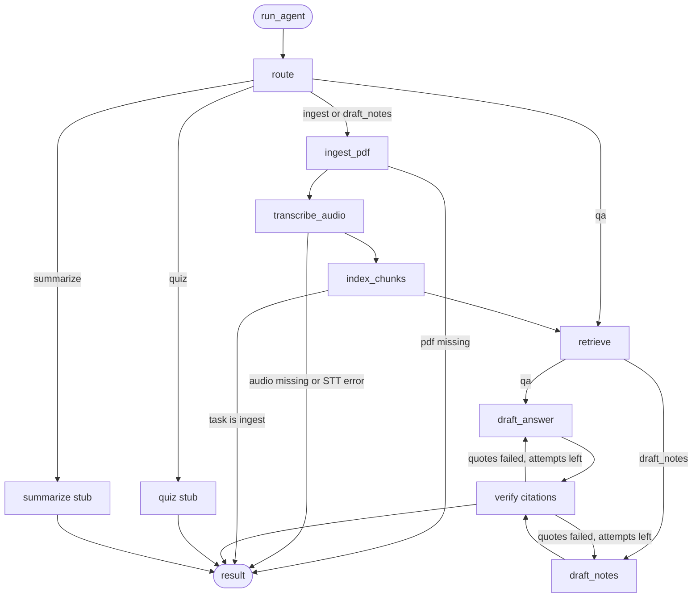

# Agent pipeline

Palpate's study tasks share one entry point, `run_agent`, and one LangGraph graph. The graph is a fixed set of branches. A request names its task (`ingest`, `draft_notes`, `qa`, and later `quiz` or `summarize`). When the caller only has a message, a keyword router picks the branch. The model never chooses which node runs. It writes claims. A deterministic check then keeps a claim only when the quote really occurs in the cited chunk.

That is the pipeline from [decision 0001](decisions/0001-pipeline-not-agent.md), drawn as a graph so ingest, notes, and Q&A can share retrieval and citation checking. LangChain's tool-calling agent would let the model pick steps, which that decision rules out. LangGraph is used as the state machine. Prompts, chunking, and the citation check stay in this repo. Model calls still go through `LLMClient`, `VisionClient`, and `SpeechToTextClient`.

## Graph



`draft_notes` reads a PDF and a recording in one pass: parse the PDF, transcribe the audio, embed both, then draft. Notes context is every chunk ingested in that request, plus a hybrid search over the same lesson, capped by `notes_context_k`. Q&A does not dump the lesson; it retrieves.

Verify allows one redraft (`max_verify_attempts` defaults to 2 calls) when the model returned citations and none of them survived, or when the JSON could not be parsed. A model that abstains, or a question with no retrieved chunks, does not call the model again. If nothing verifiable remains, the status is `insufficient_evidence` and the summary is empty.

## Data flow

```text
PDF  -> PyMuPDF lines + figure bytes + bboxes (PDF user space)
     -> vision caption (optional) saved under the figures directory
     -> section chunks, one page_bbox and one char_range span per line
audio -> SpeechToTextClient segments
      -> one transcript chunk per segment, with a time_range span
both -> embed(breadcrumb + newline + body) into the knowledge store
qa / notes -> hybrid search -> model claims -> verifier -> citations + highlights
```

Coordinates are PDF user space: origin at the bottom-left, y upward. PyMuPDF measures from the top-left; the parser converts before a bbox is stored. A frontend can draw `page_bbox` at any zoom, seek `time_range` in seconds, or select `char_range` in a text view (`c_end` is exclusive, into the chunk body).

What gets embedded is the breadcrumb plus the body, not the body alone. A line that never repeats its heading is still findable. `search_text` is Latin words plus CJK bigrams, queried with Postgres' `simple` text config. That is the precomputed-bigram option from the schema draft, so Chinese match does not depend on `pg_bigm`.

Dense cosine and lexical overlap are fused with reciprocal rank fusion (`rrf_k` 60). An emphasised chunk (teacher highlight) is then multiplied by `highlight_boost`. `min_evidence_score` still belongs to the legacy `Answerer` and is not compared to an RRF score. `min_dense_score` defaults to 0. When it is raised, a hit with lexical overlap is kept anyway, because gene names and similar identifiers are exactly what embeddings miss.

Every read filters on `owner_id`. The same file uploaded by two students is stored twice. The same file uploaded twice by one student is a no-op (`content_hash`).

## Citation shape

A verified claim looks like this. The same object is what `POST /agent/run` returns inside `citations` and, one anchor at a time, inside `highlights`.

```json
{
  "id": "c1",
  "rank": 1,
  "claim": "Milia are keratin-filled cysts on the face.",
  "quote": "Milia are 1-2 mm keratin-filled cysts on the face.",
  "doc_id": "lecture",
  "chunk_id": "lecture-0000",
  "doc_type": "slides",
  "modality": "text",
  "verified": true,
  "anchors": [
    {"kind": "page_bbox", "page": 1, "x0": 72.0, "y0": 730.0, "x1": 305.0, "y1": 754.0},
    {"kind": "char_range", "c_start": 28, "c_end": 76}
  ]
}
```

`modality` is `text`, `image`, or `audio`. An image citation's `page_bbox` is the figure rectangle, not the caption line. An audio citation's anchor is `time_range`. Note sections are rebuilt from the claims that survived verification, so a section body is not prose the checker never saw.

## Where the code lives

| Piece | Module |
| --- | --- |
| Entry point | `app.agent.service.run_agent` |
| Graph | `app.agent.graph` |
| Nodes | `app.agent.nodes` |
| Citation types | `app.agent.types` |
| Store | `app.agent.store` (`InMemoryKnowledgeStore`, `PgVectorKnowledgeStore`) |
| PDF lines and figures | `app.ingestion.parser` |
| Quote check | `app.answering.verifier` (unchanged rule) |
| Providers | `app.core.llm.LLMClient`, `app.core.providers` |
| HTTP seam | `POST /agent/run` |

`POST /documents` and `POST /worksheets` are still 501. The agent route is the seam that calls the pipeline. It accepts local paths for this stage. The schema draft's rule still holds for a real client: the server does not scan a student's disk; a client pushes bytes. Paths are how the local graph is tested.

Postgres tables are `documents`, `chunks`, and `chunk_spans` in `db/init.sql`. A volume created from the previous init script needs `db/migrations/001_agent_pipeline.sql`. The vector column stays `vector(1024)`.

## Providers

| Setting | Role |
| --- | --- |
| `PALPATE_ANSWER_MODEL_ID` | Claim drafting. Falls back to `PALPATE_BULK_MODEL_ID`. |
| `PALPATE_EMBEDDING_MODEL_ID` / `PALPATE_EMBEDDING_DIM` | Embeddings. Default Cohere multilingual v3, dim 1024. Query vs document uses Cohere's `input_type`. |
| `PALPATE_VISION_MODEL_ID` | Figure captions via Bedrock Converse. Empty means the figure is still indexed, with a nearby "Figure …" line or a positional fallback. |
| `PALPATE_STT_PROVIDER` | `""` / `none` raises a clear error if audio is passed. `transcribe` selects `AmazonTranscribeClient`, which is not wired to S3 yet. |
| `PALPATE_VECTOR_STORE` | `pgvector` (default, docker-compose) or `memory`. |

No key is read from source. Tests and `backend/examples/sample_run.py` inject stand-ins from `app.agent.standins`: a hashing embedder, a vision caption, a fixed transcript, and a drafter that copies a source line overlapping the question. The sample PDF is original text in `backend/tests/fixtures/sample_lecture.pdf`.

```bash
cd backend && uv run python examples/sample_run.py
```

## Implemented and stubbed

Implemented:

- PDF text lines and embedded figures, with page rectangles in PDF user space and character ranges.
- Optional vision captions; figure bytes saved next to the chunk.
- Audio transcription behind `SpeechToTextClient`, indexed as timestamped chunks.
- Class notes with the section template in `config/dentistry.yaml`, citing both the PDF and the recording.
- Hybrid retrieval of text and image chunks, owner and lesson filters, highlight boost, glossary expansion when a glossary is injected.
- Claim-level citations and a flat `highlights` list.
- One bounded redraft when verification fails.
- Keyword routing for quiz and summarize, which return `not_implemented`.

Stubbed or left for later:

- Amazon Transcribe (protocol only; needs an S3 upload and a job poller).
- Quiz parsing and summarize (named nodes, no model call).
- Cross-subject retrieval and the `concepts` / `chunk_concepts` passport. Widening a lesson by lowering the similarity threshold is intentionally not implemented.
- `docx` anchors. Only PDF geometry and audio time ranges are produced today.
- Row-level security. Queries filter `owner_id`, but Postgres RLS from the schema draft is not turned on.
- The legacy `POST /documents` and `POST /worksheets` handlers.
- Checkpointers, LangSmith, and tracing. The `trace` list on the result is the debug log for now.

Ids stay text, matching the existing tables, rather than the uuid keys in the schema draft.

## Open decisions

1. **Embedding model.** Still Cohere Embed Multilingual v3 and `vector(1024)`, which was already the repo default. Changing it rewrites the column. `PALPATE_EMBEDDING_DIM` must move with the model.
2. **Chinese lexical match.** Precomputed bigrams in `search_text`, not `pg_bigm`. Revisit if bigrams are too noisy on real notes.
3. **Abstention gate.** Verification plus "no chunks retrieved", not an RRF cutoff and not the old 0.35 score. `min_dense_score` exists but defaults off so a lexical-only hit can answer. The schema's margin-versus-LLM question is still open; the redraft loop is only for quotes that failed the string check.
4. **Textbooks and lesson scope.** A textbook chunk stored with a lesson id is filtered like any other chunk. The schema question (textbooks spanning every lesson) is unanswered; don't put a textbook in one lesson if it should always be visible.
5. **`.docx` highlighting.** Not supported. Render to PDF at ingest, or highlight a text view. No code chooses yet.
6. **Concept extraction.** Not in this graph. Cross-subject search should wait for named concepts rather than a lower threshold.
7. **Speech provider.** Interface is fixed; Amazon Transcribe is a stub. A hosted Whisper-compatible endpoint would be a new adapter, not a graph change.
8. **Note body.** Section markdown is the verified claim sentences, not the model's free `body_md`. Say if the UI needs the model's wording as well as the quotes.
